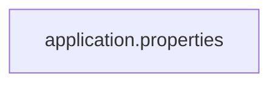
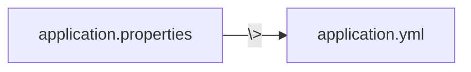
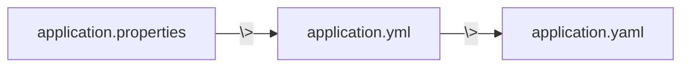
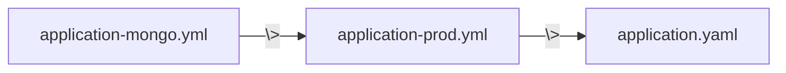
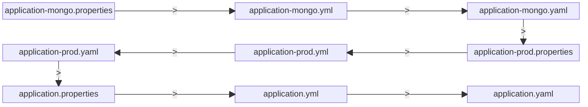

# Application Configuration

---
layout: full
class: text-left
---

## Application Configuration

```properties [src/main/resources/application.properties]
spring.application.name=demo
spring.main.lazy-initialization=true
```

<div v-click>

```yaml [src/main/resources/application.yml]
spring:
    application.name: demo
    main.lazy-initialization: true
```

</div>

<div v-click>

```yaml [src/main/resources/application.yaml]
spring:
    application.name: demo
    main.lazy-initialization: true
```

</div>

<!--
Trois moyens de fournir des properties,
avec un fichier properties,
un yml,
un yaml
-->

---
layout: full
class: text-left
---

src/main/resources/application.yml

<div v-click>

```yaml
spring:
    application.name: demo
    main.lazy-initialization: true
```

</div>
<div v-click>

```yaml
spring:
    application.name: demo
    main:
      lazy-initialization: true
```

</div>
<div v-click>

```yaml
spring:
    application.name: demo
    main:
      lazyInitialization: true
```

</div>

<!--
Trois écritures de la même propriété. Spring fait du relaxed binding : lazy-initialization et lazyInitialization désignent la même clé.
-->

---
layout: full
class: text-left
transition: fade
---

## properties



<!--
On part du fichier properties.
-->

---
layout: full
class: text-left
transition: fade
---

## properties > yml



<!--
S'il y a les deux, le properties gagne.
-->

---
layout: full
class: text-left
transition: fade
---

## properties > yml > yaml



<!--
Les fichiers properties passent avant les yml qui passent avant les yaml
-->

---
layout: full
class: text-left
transition: fade
---

## properties > yml > yaml


```properties [application.properties]
spring.application.name=demoProperties
```

```yaml [application.yml]

spring:
    application.name: demoYml
```

```yaml [application.yaml]

spring:
    application.name: demoYaml
```

<div v-click>

spring.application.name = demoProperties

</div>

---
layout: full
class: text-left
---

## Profiles

Les profils sont un moyen de séparer des parties de la configuration

Exemple:

un profile MySql

un profile MongoDb

<!--
Un profil active une partie de la configuration sans toucher au code : ici, le choix de la base de données.
-->

---
layout: full
class: text-left
---

## Profiles

```yaml [src/main/resources/application-dev.yml]
spring:
    application.name: myDevConfig
```

```yaml [src/main/resources/application-prod.yml]
spring:
    application.name: myProdConfig
```

---
layout: full
class: text-left
---

## Activer un profile

Dans les fichiers application.*

```yaml [application.yml]
spring.profiles.active: dev,mysql
```

<div v-click>

En variable d'environnement

```bash
export SPRING_PROFILES_ACTIVE=dev
```

</div>
<div v-click>

JVM parameter

```bash
java -Dspring.profiles.active=prod,mongo -jar app.jar
```

</div>
<div v-click>

Argument de l'application

```bash
java -jar app.jar --spring.profiles.active=prod,mongo
```

</div>

<!--
Par fichier de properties, uniquement dans le fichier racine

Le -D doit être avant -jar : après, il est ignoré sans erreur
-->

---
layout: full
class: text-left
---

## Ordre

```bash
-Dspring.profiles.active=prod,mongo
```



```yaml [application-mongo.yml]
spring:
    application.name: demoMongo
```

```yaml [application-prod.yml]
spring:
    application.name: demoProd
```

```yaml [application.yaml]
spring:
    application.name: demoYaml
```

<div v-click.at='1'>

spring.application.name = <span v-click.at='2'>demoMongo</span>

</div>

<!--
Les profiles sont dans l'ordre inverse
-->

---
layout: full
class: text-left
---

## Ordre

```
-Dspring.profiles.active=prod,mongo
```



<!--
Au complet si on joue avec les extensions

/!\ pas une bonne pratique
-->

---
layout: full
class: text-left
---

## Fichier de test

```yaml [src/main/resources/application.yml]
spring:
    application.name: demo
    main.lazy-initialization: true
```

```yaml [src/test/resources/application.yml]
spring:
    application.name: demoTest
```

<div v-click.at='1'>

spring.application.name = <span v-click.at='2'>demoTest</span>

spring.main.lazy-initialization = <span v-click.at='2'>non définie</span>

</div>

<div v-click.at='2'>

Même nom, même place sur le classpath : en test, ce fichier remplace celui de main en entier, sans fusion

</div>

<!--
src/test/resources passe devant src/main/resources sur le classpath

Le fichier de main n'est donc pas lu du tout : rien n'est fusionné
-->

---
layout: full
class: text-left
---

## Profil de test

```yaml [src/main/resources/application.yml]
spring:
    application.name: demo
    main.lazy-initialization: true
```

```yaml [src/test/resources/application-test.yml]
spring:
    application.name: demoTest
```

```kotlin
@SpringBootTest
@ActiveProfiles("test")
class DemoTest
```

<div v-click.at='1'>

spring.application.name = <span v-click.at='2'>demoTest</span>

spring.main.lazy-initialization = <span v-click.at='2'>true</span>

</div>

<div v-click.at='2'>

Autre nom : le fichier de profil se superpose à celui de main, sans le remplacer

</div>

<!--
Même contenu que la slide précédente, mais avec un autre nom de fichier : application-test.yml.

Le fichier de main est toujours lu, le profil test ne fait qu'écraser les clés qu'il redéfinit.
lazy-initialization vient de main, application.name vient du profil.

@ActiveProfiles est l'équivalent, en test, de SPRING_PROFILES_ACTIVE ou de -D vus plus haut
qui, eux, servent à lancer l'application.
-->

---
layout: cover
hideInToc: false
---

## Accès aux propriétés

---
layout: full
class: text-left
---

## Injection

```kotlin
@Component
class Demo(@Value("\${custom.path.value}") private val value: String)
```

<div v-click>

## Injection avec fallback

```kotlin
@Component
class Demo(@Value("\${custom.path.value:defaultValue}") private val value: String)
```

</div>

<!--
Injection par le constructeur, comme un bean, mais pour une valeur

@Value n'est résolu que sur un bean, d'où le @Component

Avec une valeur par défaut
-->

---
layout: TwoColumnsTitle
class: text-left
---

::title::

## ConfigurationProperties

::left::

```yaml {all|1-2|3}{at:'0'}
path:
  custom-prop:
    demo: val1
    anotherDemo: 42
```

::right::

````md magic-move
```kotlin {all|1|3|all}{at:'0'}
@ConfigurationProperties("path.custom-prop")
data class CustomProperties(
    val demo: String,
    val anotherDemo: Int,
)
```

```kotlin
@ConfigurationProperties("path.custom-prop")
@Validated
data class CustomProperties(
    @field:NotBlank val demo: String,
    @field:Min(10) val anotherDemo: Int,
)
```
````

<div v-click.at='3'>

```kotlin
@Configuration
@EnableConfigurationProperties(CustomProperties::class)
class PropertiesConfig
```

</div>

<!--
On peut transformer les properties en instance de class

@ConfigurationProperties donne la base du nom

@EnableConfigurationProperties active la lecture

C'est un bean, donc on peut réutiliser la validation

Comme pour un @Service : sans @Validated, les contraintes sont ignorées en silence
-->

---
layout: full
class: text-left
---

## Utilisation

EnableConfigurationProperties = Création de bean

```kotlin
@Service
class Demo(val properties: CustomProperties) {
}
```

```kotlin
@Configuration
class Demo {
    @Bean
    fun aBean(properties: CustomProperties) = Something(properties)
}
```

<!--
On injecte la classe comme un bean
-->

---
layout: full
class: text-left
---

## Conditional Bean

````md magic-move
```kotlin
@Configuration
class DatabaseConfig {

    @ConditionalOnProperty("db.external", havingValue = "true")
    @Bean
    fun mongo(): Database = UserMongoRepository()
}
```

```kotlin
@Configuration
class DatabaseConfig {

    @ConditionalOnProperty("db.external", havingValue = "true")
    @Bean
    fun mongo(): Database = UserMongoRepository()

    @ConditionalOnProperty("db.external", havingValue = "false")
    @Bean
    fun inMemory(): Database = UserInMemoryRepository()
}
```

```kotlin
@Configuration
class DatabaseConfig {

    @ConditionalOnProperty("db.external", havingValue = "true")
    @Bean
    fun mongo(): Database = UserMongoRepository()

    @ConditionalOnProperty("db.external", havingValue = "false", matchIfMissing = true)
    @Bean
    fun inMemory(): Database = UserInMemoryRepository()
}
```
````

<!--
ConditionalOnProperty permet de créer le bean si la condition est validé

Donc on peut avoir donc un bean suivant le contenu de la variable

Et le matchIfMissing permet d'avoir un comportement par défaut
-->

---
layout: full
class: text-left
---

## Conditional Bean on Profile

```kotlin
@Configuration
class DatabaseConfig {

    @Bean
    @Profile("mongo")
    fun mongo(): Database = UserMongoRepository()

    @Bean
    @Profile("!mongo")
    fun inMemory(): Database = UserInMemoryRepository()
}
```

<!--
On peut aussi conditionner des beans sur des profiles
-->

---
layout: TwoColumnsTitle
class: text-left
---

::title::

## ConditionalOn

::left::

ConditionalOnProperty

ConditionalOnBean

ConditionalOnMissingBean

ConditionalOnClass

ConditionalOnJava

ConditionalOnResource

ConditionalOnExpression

ConditionalOnJndi

ConditionalOnThreading

::right::

ConditionalOnNotWarDeployment

ConditionalOnNotWebApplication

ConditionalOnCheckpointRestore

ConditionalOnCloudPlatform

ConditionalOnSingleCandidate

ConditionalOnWarDeployment

ConditionalOnWebApplication

ConditionalOnMissingClass

<!--
Il y a beaucoup de ConditionalOn*

ConditionalOnBean sur l'existence d'un bean

ConditionalOnClass sur l'existence d'une class dans le classpath

ConditionalOnJava sur la version de java

-->
