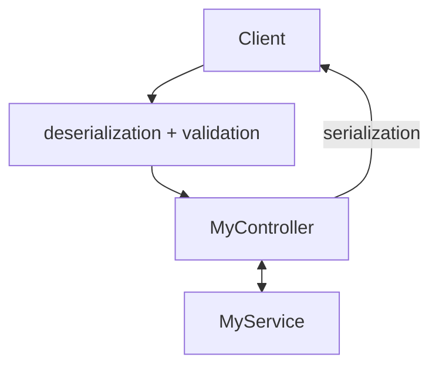
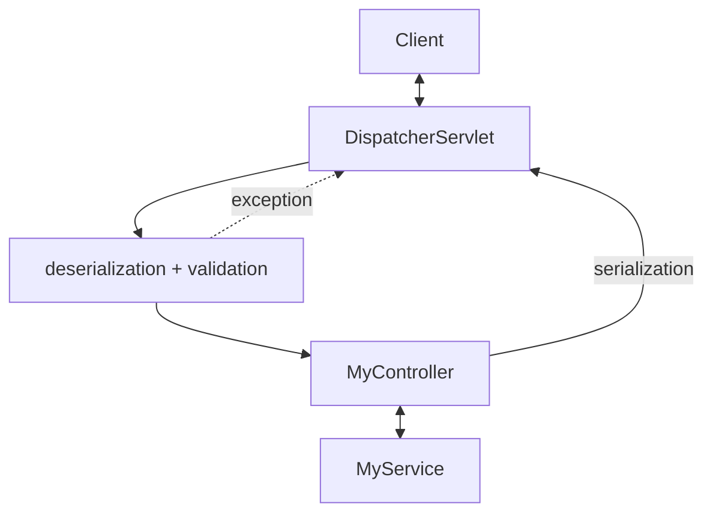
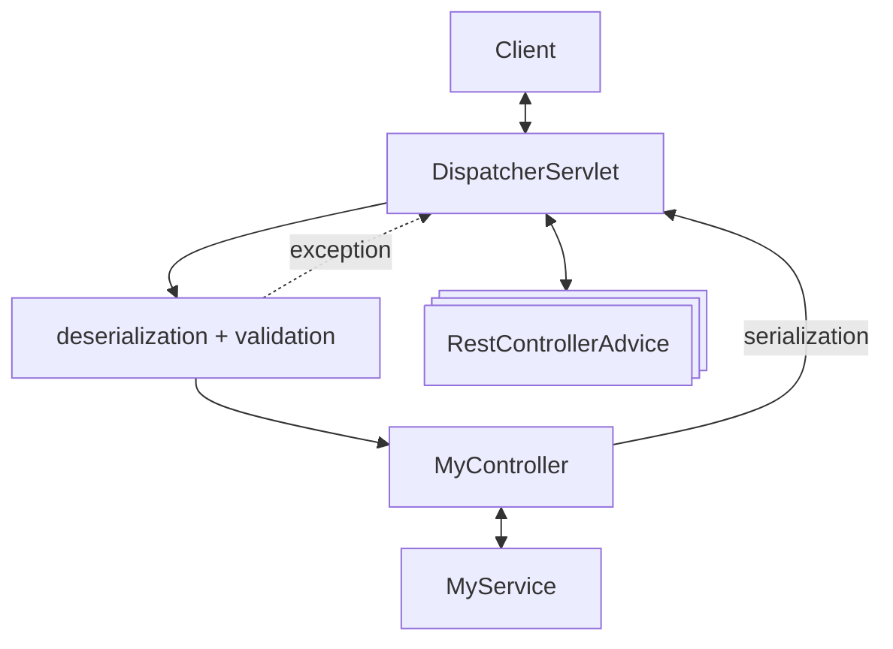

# Gestion des erreurs

---
layout: full
class: text-left
---

## Où est passée l'erreur ?

```kotlin
@PostMapping
fun create(@RequestBody @Valid dto: DemoDto): DemoDto {
    println("Dans la méthode !")
    return demoService.save(dto)
}
```

```bash
curl -i -X POST localhost:8080/api/v1/demo \
     -H 'Content-Type: application/json' -d '{"name":""}'
```

<div v-click>

```txt
HTTP/1.1 400
```

Console : **rien**, le `println` ne s'affiche jamais.

</div>

<div v-click class="text-2xl mt-6 text-center">

Si l'erreur de validation n'entre pas dans la méthode, **elle est gérée où ?**

</div>

<!--
On reprend la validation : un POST avec un nom vide.

Spring répond 400, et pourtant le println ne s'affiche pas :
on n'est jamais entré dans la méthode.

Il y a donc forcément du code qui tourne avant elle.
-->

---
layout: TwoColumnsTitle
class: text-left
transition: fade
glowSeed: 1144
---

::title::

## Trajet d'une requête (vue simplifiée)

::left::



::right::

<!--
Vision simple d'une application.

La requête est désérialisée et validée avant d'arriver au contrôleur.
La réponse est sérialisée au retour.
-->

---
layout: TwoColumnsTitle
class: text-left
transition: fade
glowSeed: 1144
---

::title::

## Trajet d'une requête (vue simplifiée)

::left::



::right::

```kotlin {all|3-7|5|8-10}
fun dispatch(request: Request): Response {
    try {
        val handler = getHandler(request)
        val parameters = deserialize(request, handler)
        validate(parameters)
        val response = handler.handle(parameters)
        return serialize(response)
    } catch (e: Exception) {
        val response = errorHandlers
            .first { it.supports(e) }.handle(e)
        return serialize(response)
    }
}
```

<!--
En rentrant un peu dans Spring, il y a une couche entre la servlet et le contrôleur : le DispatcherServlet.

En pseudo-code, il fait ça. C'est une vision très très simplifiée.

Il cherche d'abord le handler : sans lui, impossible de connaître le type à désérialiser.
Puis il désérialise, valide, et seulement ensuite il appelle notre méthode.

validate lève l'exception avant handler.handle : voilà pourquoi on n'entre jamais dans la méthode.

L'exception tombe dans le catch : la gestion est externe et générique.
Ce catch reçoit aussi ce que lancent le contrôleur et le service.
-->

---
layout: TwoColumnsTitle
class: text-left
glowSeed: 1144
---

::title::

## Trajet d'une requête (vue simplifiée)

::left::



::right::

```kotlin {9-10}
fun dispatch(request: Request): Response {
    try {
        val handler = getHandler(request)
        val parameters = deserialize(request, handler)
        validate(parameters)
        val response = handler.handle(parameters)
        return serialize(response)
    } catch (e: Exception) {
        val response = errorHandlers
            .first { it.supports(e) }.handle(e)
        return serialize(response)
    }
}
```

<!--
errorHandlers, c'est une pile : le premier qui sait traiter l'exception répond.

Nos RestControllerAdvice sont en haut de la pile.
Derrière, Spring a ses propres handlers :
c'est pour ça qu'une validation répond déjà 400 sans qu'on écrive rien.

Si personne ne sait traiter l'exception, elle est relancée et sort du DispatcherServlet.
En test, MockMvc ne donne donc pas de 500 :
l'exception sort de mockMvc.get sous forme de ServletException et fait échouer le test.
-->

---
layout: full
class: text-left
---

## RestControllerAdvice

````md magic-move
```kotlin
@RestControllerAdvice
class HttpErrorHandler {
}
```

```kotlin
@RestControllerAdvice
class HttpErrorHandler {

    fun handleMethodArgumentNotValid(e: MethodArgumentNotValidException) =
        ResponseEntity.badRequest().body("Your arg is invalid")
}
```
```kotlin
@RestControllerAdvice
class HttpErrorHandler {

    @ExceptionHandler(MethodArgumentNotValidException::class)
    fun handleMethodArgumentNotValid(e: MethodArgumentNotValidException) =
        ResponseEntity.badRequest().body("Your arg is invalid")
}
```
```kotlin {4-5}
@RestControllerAdvice
class HttpErrorHandler {

    @ExceptionHandler(MethodArgumentNotValidException::class)
    fun handleMethodArgumentNotValid(e: MethodArgumentNotValidException) =
        ResponseEntity.badRequest().body("Your arg is invalid")
}
```

```kotlin
@RestControllerAdvice
class HttpErrorHandler {

    @ExceptionHandler(MethodArgumentNotValidException::class)
    fun handleMethodArgumentNotValid(e: MethodArgumentNotValidException) =
        ResponseEntity.badRequest().body("Your arg is invalid")

    @ExceptionHandler(Exception::class)
    fun fallback(e: Exception) =
        ResponseEntity.internalServerError().body("Unhandled error")
}
```
````

<!--
Un RestControllerAdvice est un Bean particulier.
Comme RestController ou @Configuration,
il a son propre cycle de vie.

On peut lui donner des methodes pour lui expliquer comment traiter une exception

Comme le RestController, 
il faut une annotation pour que Spring puisse faire le lien

La gestion, des exceptions, est en entonnoir

On peut traiter les erreurs spécialisées et avoir des couches de traitement de plus en plus génériques

⚠️ MethodArgumentNotValidException ne concerne que @Valid sur un @RequestBody.
Une contrainte sur un paramètre (@RequestParam, @PathVariable) lève HandlerMethodValidationException :
ce handler ne la traite pas.

Piège du fallback sur Exception : dans un advice écrit à la main, il capte aussi toutes les exceptions de Spring MVC.
Une validation de paramètre qui devait donner 400 répond alors 500.
La slide suivante règle ça.
-->

---
layout: full
class: text-left
---

## RestControllerAdvice - Spring

````md magic-move
```kotlin
@RestControllerAdvice
class HttpErrorHandler : ResponseEntityExceptionHandler() {
}
```
```kotlin
@RestControllerAdvice
class HttpErrorHandler : ResponseEntityExceptionHandler() {

  override fun handleMethodArgumentNotValid(e: MethodArgumentNotValidException,
                                            headers: HttpHeaders,
                                            status: HttpStatusCode,
                                            request: WebRequest)
                                            : ResponseEntity<Any>? {
      return ResponseEntity.badRequest().body("Your arg is invalid")
  }
}
```

```kotlin
@RestControllerAdvice
class HttpErrorHandler : ResponseEntityExceptionHandler() {

  override fun handleMethodArgumentNotValid(e: MethodArgumentNotValidException,
                                            headers: HttpHeaders,
                                            status: HttpStatusCode,
                                            request: WebRequest)
                                            : ResponseEntity<Any>? {
      return ResponseEntity.badRequest().body("Your arg is invalid")
  }

  @ExceptionHandler(DemoNotFoundException::class)
  fun handleDemoNotFound(e: DemoNotFoundException) =
      ResponseEntity.status(HttpStatus.NOT_FOUND).body("Demo not found")
}
```

```kotlin
@RestControllerAdvice
class HttpErrorHandler : ResponseEntityExceptionHandler() {

  override fun handleMethodArgumentNotValid(e: MethodArgumentNotValidException,
                                            headers: HttpHeaders,
                                            status: HttpStatusCode,
                                            request: WebRequest)
                                            : ResponseEntity<Any>? {
      return ResponseEntity.badRequest().body("Your arg is invalid")
  }

  @ExceptionHandler(DemoNotFoundException::class)
  fun handleDemoNotFound(e: DemoNotFoundException) =
      ProblemDetail.forStatusAndDetail(HttpStatus.NOT_FOUND, "Demo not found")
}
```
````

<!--
Il est aussi possible d'étendre la gestion par défaut de Spring

Pour ça il faut étendre ResponseEntityExceptionHandler et surcharger les handlers

Cette classe traite déjà les exceptions de Spring MVC, dont HandlerMethodValidationException : elle répond 400.
On ne surcharge que ce qu'on veut personnaliser (ici le body d'une validation de @RequestBody),
le reste garde le comportement par défaut.

Nos handlers peuvent répondre au format vu avec la validation (ProblemDetail, RFC 9457, application/problem+json) :
il suffit de retourner un ProblemDetail, Spring en déduit le status et le content type.
-->

---
layout: full
class: text-left
glowSeed: 1144
---

## TL;DR Erreurs

| Besoin | Comment |
|---|---|
| Traduire une exception | `@RestControllerAdvice` + `@ExceptionHandler` |
| Garder la gestion de Spring | `: ResponseEntityExceptionHandler()` |
| ProblemDetail, sans écrire d'advice | `spring.mvc.problemdetails.enabled: true` |
| Tester | `@WebMvcTest` charge l'advice, rien à ajouter |

```kotlin
@RestControllerAdvice
class HttpErrorHandler : ResponseEntityExceptionHandler() {

    @ExceptionHandler(DemoNotFoundException::class)
    fun handleDemoNotFound(e: DemoNotFoundException) =
        ProblemDetail.forStatusAndDetail(HttpStatus.NOT_FOUND, "Demo not found")
}
```

<style>
:not(pre) > code {
  background: rgba(255, 255, 255, 0.12);
  color: inherit;
  padding: 0 0.3em;
  border-radius: 0.25em;
  font-size: 0.85em;
}
</style>

<!--
Qu'elle vienne de la validation ou du service, l'erreur remonte au DispatcherServlet :
la gestion est externe et générique.

Sans écrire d'advice, la propriété active ProblemDetail pour les exceptions de Spring MVC.

⚠️ La propriété n'a aucun effet si un advice étend déjà ResponseEntityExceptionHandler.
Ce n'est pas un problème : cette classe répond déjà en ProblemDetail pour les exceptions de Spring MVC.

Ici on ne surcharge plus handleMethodArgumentNotValid : l'override renvoyait un String,
sans lui une validation reste en ProblemDetail.

@WebMvcTest charge aussi les RestControllerAdvice :
le handler est actif sans rien importer, on teste donc la réponse HTTP complète.
-->
