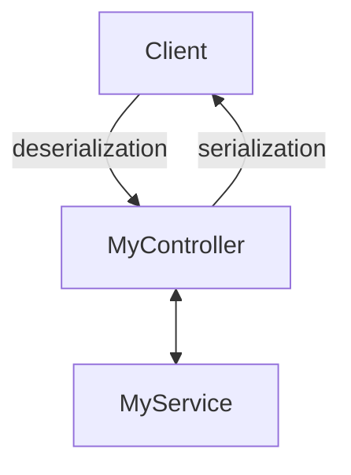
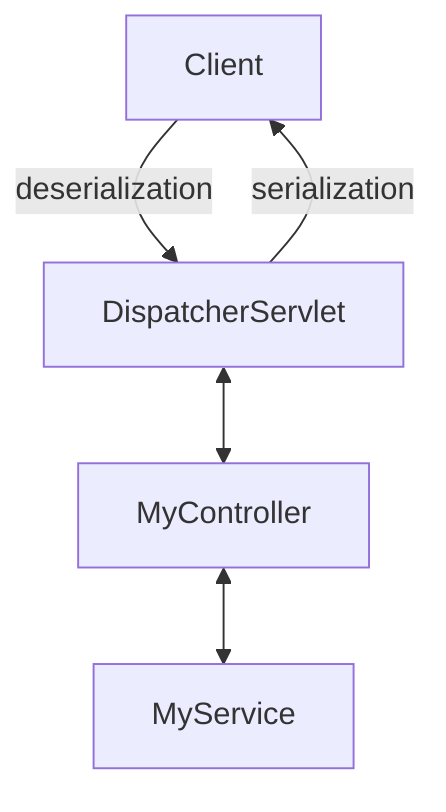
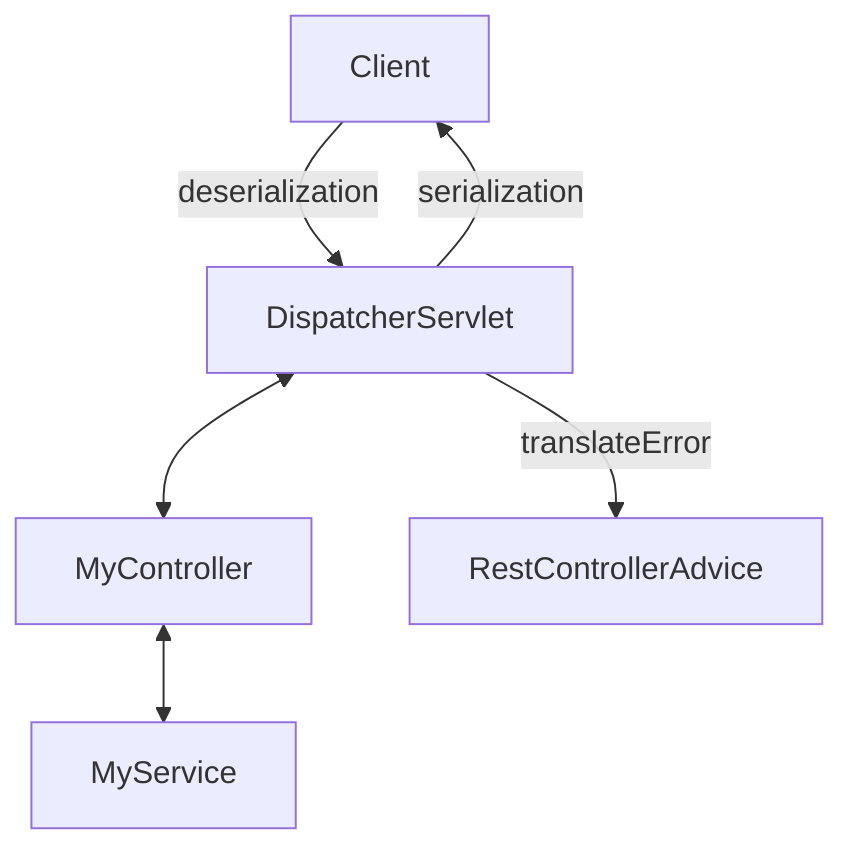

# Gestion des erreurs

---
layout: full
class: text-left
---

## Gestion des erreurs

Les erreurs de validation n'entrent pas dans le code de la fonction.

La gestion est externe et générique.

---
layout: full
---

## Current schema



<!--
Vision simple d'une application
-->

---
layout: full
---

## DispatcherServlet



<!--
En rentrant un peu dans spring,
il y a une couche pour passer de la servlet au controlleur
-->

---
layout: full
---

## DispatcherServlet



<!--
Ce dispatcher va gérer les erreurs en s'appuyant sur un RestControllerAdvice
-->

---
layout: full
class: text-left
---

## DispatcherServlet - PSEUDO-code

```kotlin
fun dispatch(request: HttpServletRequest) {
    try {
        val parameters = deserialize(request)
        val handler = getHandler(request)
        val response = handler.handle(parameters)
        return serialize(response)
    } catch (e: Exception) {
        val response = errorHandler.handle(e)
        return serialize(response)
    }
}
```

<!--
Autrement dit en pseudo code il fait ca.
C'est une vision très très simplifiée.
-->

---
layout: full
class: text-left
---

## RestControllerAdvice

````md magic-move
```kotlin
@RestControllerAdvice
class HttpErrorHandler {
}
```

```kotlin
@RestControllerAdvice
class HttpErrorHandler {

    fun handleMethodArgumentNotValid(e: MethodArgumentNotValidException) =
        ResponseEntity.badRequest().body("Your arg is invalid")
}
```
```kotlin
@RestControllerAdvice
class HttpErrorHandler {

    @ExceptionHandler(MethodArgumentNotValidException::class)
    fun handleMethodArgumentNotValid(e: MethodArgumentNotValidException) =
        ResponseEntity.badRequest().body("Your arg is invalid")
}
```
```kotlin {4-5}
@RestControllerAdvice
class HttpErrorHandler {

    @ExceptionHandler(MethodArgumentNotValidException::class)
    fun handleMethodArgumentNotValid(e: MethodArgumentNotValidException) =
        ResponseEntity.badRequest().body("Your arg is invalid")
}
```

```kotlin
@RestControllerAdvice
class HttpErrorHandler {

    @ExceptionHandler(MethodArgumentNotValidException::class)
    fun handleMethodArgumentNotValid(e: MethodArgumentNotValidException) =
        ResponseEntity.badRequest().body("Your arg is invalid")

    @ExceptionHandler(Exception::class)
    fun fallback(e: Exception) =
        ResponseEntity.internalServerError().body("Unhandled error")
}
```
````

<!--
Un RestControllerAdvice est un Bean particulier.
Comme RestController ou @Configuration,
il a son propre cycle de vie.

On peut lui donner des methodes pour lui expliquer comment traiter une exception

Comme le RestController, 
il faut une annotation pour que Spring puisse faire le lien

La gestion, des exceptions, est en entonnoir

On peut traiter les erreurs spécialisées et avoir des couches de traitement de plus en plus génériques
-->

---
layout: full
class: text-left
---

## RestControllerAdvice - Spring

````md magic-move
```kotlin
@RestControllerAdvice
class HttpErrorHandler : ResponseEntityExceptionHandler() {
}
```
```kotlin
@RestControllerAdvice
class HttpErrorHandler : ResponseEntityExceptionHandler() {

  override fun handleMethodArgumentNotValid(e: MethodArgumentNotValidException,
                                            headers: HttpHeaders,
                                            status: HttpStatusCode,
                                            request: WebRequest)
                                            : ResponseEntity<Any>? {
      return ResponseEntity.badRequest().body("Your arg is invalid")
  }
}
```

```kotlin
@RestControllerAdvice
class HttpErrorHandler : ResponseEntityExceptionHandler() {

  override fun handleMethodArgumentNotValid(e: MethodArgumentNotValidException,
                                            headers: HttpHeaders,
                                            status: HttpStatusCode,
                                            request: WebRequest)
                                            : ResponseEntity<Any>? {
      return ResponseEntity.badRequest().body("Your arg is invalid")
  }

  @ExceptionHandler(DemoNotFoundException::class)
  fun handleDemoNotFound(e: DemoNotFoundException) =
      ResponseEntity.status(HttpStatus.NOT_FOUND).body("Demo not found")
}
```
````

<!--
Il est aussi possible d'étendre la gestion par défaut de Spring

Pour ça il faut étendre ResponseEntityExceptionHandler et surcharger les handlers
-->

---
layout: full
class: text-left
---

## Layered test

````md magic-move
```kotlin
@WebMvcTest(DemoController::class)
class DemoControllerTest {

    @MockkBean
    private lateinit var demoService: DemoService
    @Autowired
    private lateinit var mockMvc: MockMvc

    @Test
    fun `invalid body gives 400`() {
        mockMvc.post("/api/v1/demo") {
            contentType = MediaType.APPLICATION_JSON
            content = """{"name":""}"""
        }.andExpect {
            status { isBadRequest() }
            content { string("Your arg is invalid") }
        }
    }
}
```
```kotlin
@WebMvcTest(DemoController::class)
class DemoControllerTest {

    @MockkBean
    private lateinit var demoService: DemoService
    @Autowired
    private lateinit var mockMvc: MockMvc

    @Test
    fun `unknown id gives 404`() {
        every { demoService.findById(42) } throws DemoNotFoundException()

        mockMvc.get("/api/v1/demo/42")
            .andExpect {
                status { isNotFound() }
                content { string("Demo not found") }
            }
    }
}
```
````

<!--
@WebMvcTest charge aussi les RestControllerAdvice :
le handler est actif sans rien importer, on teste donc la réponse HTTP complète.

Premier test : la validation rejette le body avant d'entrer dans le contrôleur.
Le service n'est pas stubbé, il n'est jamais appelé.
On vérifie le body : sans notre handler, Spring répond déjà 400, mais avec un body vide.

Deuxième test : le service mocké lance l'exception, le handler la traduit en 404.

Sans handler, MockMvc ne donne pas de 500 :
l'exception sort de mockMvc.get sous forme de ServletException et fait échouer le test.
-->
